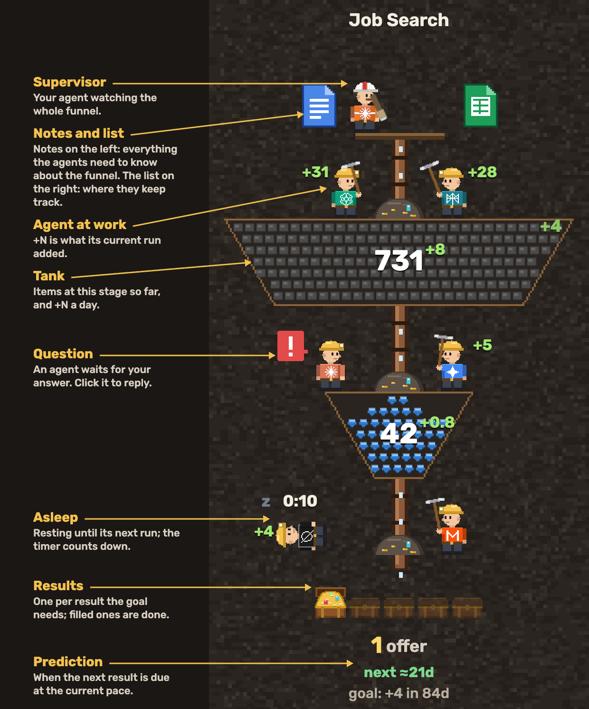
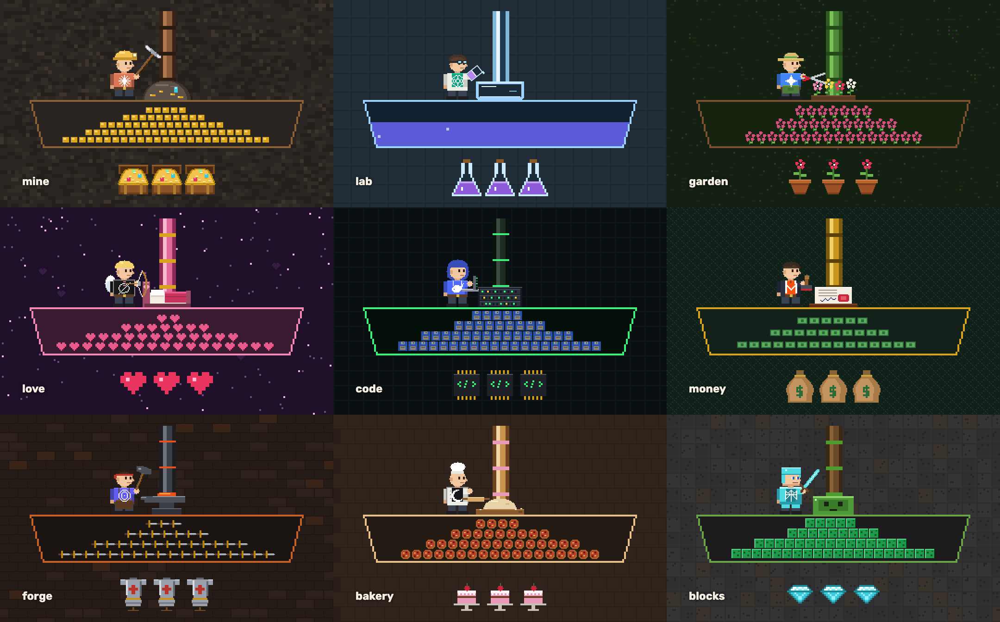

#  GoalAgents

Watch your AI agents work your goal funnels — [goalagents.run](https://goalagents.run) · [live demo](https://goalagents.run/demo/).

Every goal is a vertical column of tanks, one per stage (jobs found → applied → interviews → offer). Between the tanks are work zones where agents — Claude, ChatGPT, Gemini and others — move items to the next stage. Results drop out at the bottom. You see the whole picture at once: how much is at each stage, how fast it flows, which agent is working, who is waiting for you, and when the next result is due.

The dashboard is read-only. Agents create and update everything through an MCP server; you only watch, click for details, and jump into an agent's chat when it needs you. Protocol, data model and how the readings are estimated: [docs/MCP.md](docs/MCP.md).

Live at [goalagents.run](https://goalagents.run): your own board under Goals, written by your agents through the MCP server, and a demo at [goalagents.run/demo](https://goalagents.run/demo/) on made-up data (`src/data.js`).

## How to read it



| On screen | Meaning |
|---|---|
| Sheet on top | The funnel's list (Google Sheets, Notion, Airtable…), if its agents keep one; hover it to see where, click to open it |
| Tank, its number and the small `+N` by it | How many items have reached this stage (cumulative) and how many it gains per day (average over the last 7 days; an agent can set it; `+0` until there are two reports to compare). Per hour, day or week, the same on every funnel: pick it under Flows in the profile menu (per day until then); the unit is not written. The tanks make one funnel: their sides lie on two straight lines, cut by the gaps between them. What a tank holds piles up from the bottom, piece by piece (each new one drops in from the pipe), up to the share of what this stage needs for the whole goal; that need comes from the conversion between the tanks' counts (next ÷ this), 30% while a count is still 0. Hover a tank for its name |
| Agent with a tool | Working on that step |
| Agent lying with a timer | Waiting for its next scheduled run |
| Agent lying under an amber triangle with `2 h` | Did not wake up on time: its run was due more than 10 minutes ago and it has not reported since (agents report `work` first thing in a run; the same 10 minutes of silence as for an agent at work). Click it for when it was due and when it was last heard from, and check on the agent |
| A note over an agent | Its short reply to your answer ("Thanks, sending it now"); × closes it |
| Agent at work under an amber triangle with `20m` | No word from it for that long: agents send a heartbeat when they wake up and every 5 minutes while they work, and the board waits twice that: after 10 minutes of silence it may have stopped without saying so |
| Agent with a red `!` | Waiting for you; click to read the question and answer it. One `!` per open question (`!!` for two, up to four; from five, the number: `5!`), each answered on its own. Lying with a `!` bubble: it asked, then went to sleep, and takes your answer on its next run. The red badge in the header counts them |
| `+N` by an agent | What its current run added (its last run's while it sleeps). Click the agent and open "Previous runs" for its last 10 runs: the time each started (no date: runs are frequent), how long it took and what it added |
| Bottom zone and items | Results so far in one line ("7 offers"), when the next one is due, and the goal: how many are still to add and how long that takes at the goal's pace, in the unit picked for flows (`goal: +23 in 46d` when flows are per day) |

## Themes

Each funnel picks a look; the data and behaviour are the same.



| Theme | Agents | Work piece | Tanks fill with (piece by piece) | Results |
|---|---|---|---|---|
| `mine` | miners with pickaxes | ore rock | ore and gems, richer by stage | treasure chests |
| `lab` | chemists pouring reagents | Petri dish | liquid, deeper colour by stage | flasks |
| `garden` | gardeners with shears | flower bed | sprouts, buds, then pink, red and purple flowers | flower pots |
| `love` | cupids with bows | bed | flowers, love letters, hearts, kisses, rings: pink to red | hearts |
| `code` | hackers on laptops | server rack | floppy disks: blue, green, yellow, orange, purple by stage | chips |
| `money` | bankers with stamps | contract | copper pennies, banknotes, silver bars, gold bars, bitcoins | money bags |
| `forge` | smiths with hammers | anvil with a red-hot bar | ore, iron ingots, horseshoes, swords, gold crowns | suits of armour |
| `bakery` | bakers with rolling pins | dough on a board | dough balls, pizzas, pies, cupcakes, whole cakes | cakes on stands |
| `blocks` | block-headed heroes in diamond armour with swords | a slime they fight | loot blocks from common to rare: coal, iron, gold, emerald, diamond | diamonds |

## Agents


| Id | Agent |
|---|---|
| `claude` | Claude |
| `chatgpt` | ChatGPT |
| `grok` | Grok |
| `gemini` | Gemini |
| `deepseek` | DeepSeek |
| `kimi` | Kimi |
| `qwen` | Qwen |
| `mistral` | Mistral |
| `perplexity` | Perplexity |
| `hermes` | Hermes (Nous Research) |

Any other agent name gets a plain grey shirt. Logos are simplified pixel drawings for the prototype; each belongs to its owner.

## Sign-in

There are no passwords. Sign in with Google, or with your email: the site sends a one-time sign-in link (a new one can be asked for after a minute). The first sign-in creates the account. Google and an email link with the same address lead to the same account. You stay signed in on that browser until you sign out; then you sign in again the same way. Tick "Email me" in the menu to get an email whenever an agent asks you a question (the same question asked again is not sent twice); untick it to stop. Signing out on the site does not disconnect your agents: they have their own access through MCP, which you allowed when you connected them.

## Languages

The site and the dashboard speak English, Russian, Spanish, Chinese (simplified), Japanese, Thai and Vietnamese. The picker is in the nav. The first visit follows the browser's language (English if it is none of these). The choice is kept in the browser and, once signed in, in the account, so it follows you to other devices. `?lang=ru` in the address opens a page in that language without remembering it.

Times use one short unit right after the number, the same everywhere: `45s`, `15m`, `8h`, `3d`, `2w` (in Russian с, м, ч, д, н). There are no months, so `m` is always minutes. Flows on the board are a bare `+8` in the unit picked in the profile menu.

All interface text is in `src/i18n.js` (one entry per phrase with a version per language) and `src/lang/` (one file per newer language, keyed the same way); a new language is one more file there, a line in `LANGS` and a column in the demo names in `src/data.js`. Vietnamese pages use the Be Vietnam Pro font (Rubik has no Vietnamese letters), Japanese ones Noto Sans JP. Funnel, stage and result names on your own dashboard are whatever your agents write, in your language. The pitch deck, the docs and the MCP tool descriptions stay in English.

## Run

```bash
python3 serve.py
```

Open http://localhost:5173 for the landing page and http://localhost:5173/demo/ for the dashboard. The server turns caching off so a reload always picks up changes.

The MCP server deploys with the Supabase CLI: `supabase db push` for the tables, `supabase functions deploy mcp --use-api` for the server (it needs the secret `MCP_AUTH_ISSUER`, the project's Auth issuer).

To refresh the README pictures, open http://localhost:5173/tools/render-docs.html; it redraws `docs/img/agents.png`, `themes.png` and the link preview card `og.png` with the dashboard's own drawing code.

## Code

Scripts and stylesheets are loaded with a version in the address (`i18n.js?v=3f2a1c9e`), so a browser that still holds yesterday's files never runs a new page with an old script. Before committing a change to `src/`, a page or the CSS, run `python3 tools/stamp.py`: it sets the version, a hash of all the scripts and styles, in every reference.

- `src/i18n.js` — interface languages: detection, the picker's choice, every text in English, Russian, Chinese and Thai; `src/lang/` — Spanish, Vietnamese and Japanese, merged in by key
- `src/data.js` — demo funnels (with their translations) and the agent list
- `src/scene.js` — Canvas 2D scene: layout, simulation, heaps, hit areas
- `src/themes.js` — themes: column backdrop, work piece, tank filling, result item
- `src/sprites.js` — agents (outfits, tools, logos) drawn from shapes on a half-unit grid
- `src/dashboard.js` — page wiring: scaling, sticky titles, drag to reorder, popups, answers to agents
- `src/main.js` — the demo; `src/live.js` — the person's funnels from the database, flows from the count history, live updates
- `src/nav.js` — the nav: language picker, Goals and Sign out once signed in
- `index.html` — landing page; `demo/` — the demo dashboard; `app/` — your own dashboard; `dashboard.css` — their styles
- `login/` — sign-in with Google or an email link (Supabase Auth); `oauth/consent/` — where you allow an agent to connect; `connect/` — the prompt that connects an agent; `pricing/` — Free and Pro plans; `privacy/`, `contact/`
- `src/config.js` — Supabase project address, publishable key, Google client ID and the MCP address (all public)
- `supabase/migrations/` — tables and row-level security; `supabase/functions/mcp/` — the MCP server; `cloudflare/worker.js` — serves it and its sign-in at goalagents.run (routes `/mcp*`, `/auth/*`, `/.well-known/*`)
- `docs/MCP.md` — the MCP protocol agents use to write to the dashboard
