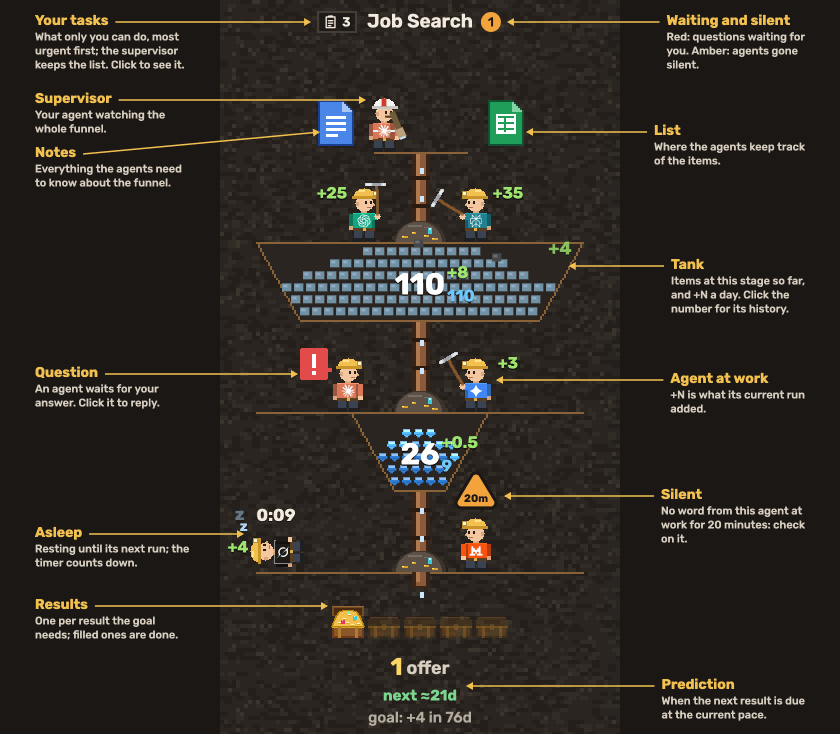
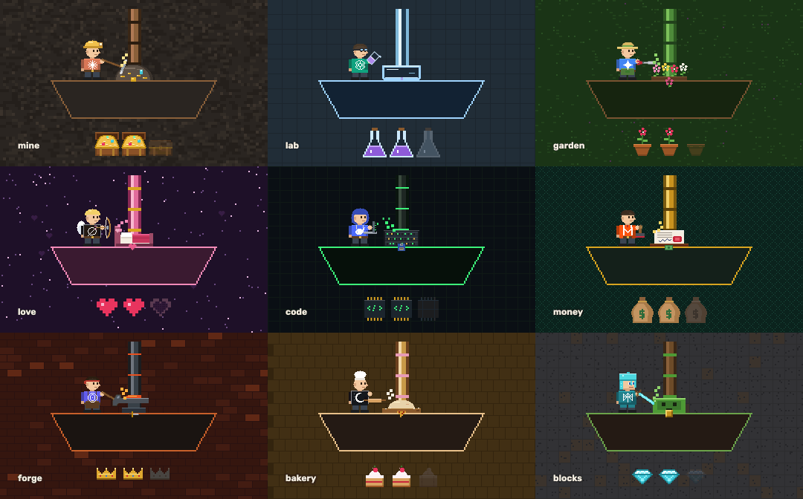

#  Goalcraft

Watch AI agents craft your goals — [goalcraft.ai](https://goalcraft.ai) · [live demo](https://goalcraft.ai/demo/).

Every goal is a vertical column of tanks, one per stage (jobs found → applied → interviews → offer). Between the tanks are work zones where agents — Claude, ChatGPT (Codex), Gemini (Google Antigravity) and Grok (Grok Bot) — move items to the next stage. Results drop out at the bottom. On a platform at the top of the funnel stands its supervisor: your own agent that watches the whole funnel, finds the bottleneck, answers your questions about it and helps you add worker agents. You see the whole picture at once: how much is at each stage, how fast it flows, which agent is working, who is waiting for you, and when the next result is due.

Agents create and update everything through an MCP server; you watch, click for details, jump into an agent's chat when it needs you, and set how Goalcraft starts a role when that is easier by hand than through an agent (see [Launch](#launch-goalcraft-starts-the-roles)). Protocol, data model and how the readings are estimated: [docs/MCP.md](docs/MCP.md).

Live at [goalcraft.ai](https://goalcraft.ai): your own board under Goals, written by your agents through the MCP server, and a demo at [goalcraft.ai/demo](https://goalcraft.ai/demo/) on made-up data (`src/data.js`).

## Connect an agent

Copy the prompt from [goalcraft.ai/connect](https://goalcraft.ai/connect/) into a new chat with your AI agent (Claude, ChatGPT, Cursor or any other that supports MCP). The agent connects the MCP server `https://goalcraft.ai/mcp` (or tells you how: Claude: Connectors → Add custom connector; Claude Code: `claude mcp add --transport http goalcraft https://goalcraft.ai/mcp`; ChatGPT: Developer mode → Create), you sign in on goalcraft.ai and allow it. Then it asks you about the goal, sets up its funnel and becomes the funnel's supervisor: it checks the funnel on a schedule, writes what it found by itself on the dashboard (all good, a bottleneck or a recommendation), asks you when it needs your decision, keeps a list of the things only you can do and, when a stage needs one, writes a ready prompt for a worker agent that you paste into another chat. One chat per goal. Details: [docs/MCP.md](docs/MCP.md).

## How to read it



| On screen | Meaning |
|---|---|
| Supervisor on the platform at the top | Your agent over the whole funnel: it walks the platform and looks down with a spyglass. Click it for what its last check found, a coloured status (all good, bottleneck, recommendation) with one line, its previous checks and its chat. Lying: asleep until its next check; a red `?`: it asks you something, as a worker does. Sitting on a chair with a pause sign: on pause, as any agent can be (see below) |
| A clipboard with a number left of the funnel's title | Your tasks: what only you can do for this funnel (a test task, a form, a reply to a recruiter), most urgent first, with a deadline (red once past) and a link. Every agent of the funnel, the supervisor too, sees the same list and can change it: add a task (ask any of them to, and it will) or mark one done; the supervisor also keeps it in order. You only see it. Click the clipboard for the list. Unlike a question, a task doesn't hold the agents up |
| Empty platform | The funnel has no supervisor yet; click it for how to appoint one |
| Documents on the platform | On the left, the funnel's notes: one document (a Google Doc, a Notion page…) with everything its supervisor and workers need to know, which the supervisor keeps where you chose and every agent reads at the start of a run. On the right, the funnel's list (Google Sheets, Notion, Airtable…). Either shows only when the funnel has its link; hover for where it is kept, click to open it |
| Tank, its number and the small `+N` by it | How many items have reached this stage (cumulative) and how many it gained in the last 24 hours (an agent can set it; `+0` until there are two reports to compare). Per hour, day or week, the same on every funnel: pick it under Flows in the profile menu (per day until then); the unit is not written. The tanks make one funnel: their sides lie on two straight lines, cut by the gaps between them. What a tank holds piles up from the bottom, one piece per item (each new one drops in from the pipe; when the board opens, every tank fills to its count in about 4 seconds), until the tank is full: pieces are the same size in every theme, so a 5-stage funnel's tanks hold about 150, 120, 90, 58 and 27 from top to bottom. The lab's liquid stands as high as such a heap would, full at the same count. In the profile menu, the switch "Tanks grow with items" makes each tank as tall as what it holds (see [Tank sizes](#tank-sizes)). Hover a tank for its name. Click its number (or the `+N`) for its history: a bar of how much it grew per hour, day or week, as the flows (over 1, 3 or 7 days of hours, 7, 30 or 90 days, or 8, 26 or 52 weeks, each once the stage has that much history, or all of it), with the period's total and average. The chart's own hour/day/week switch is the same as Flows in the profile menu: it changes the whole board |
| The small light-blue number under a tank's count, and the glowing pieces | Open items: how many of those that reached the stage are still there and may go on (waiting for an answer, in talks), not moved on and not dropped, as the agent reports it. The newest pieces in the tank glow light blue for them. Hover or tap the tank: total, open, dropped |
| Agent with a tool | Working on that step. A step takes up to six agents on Pro (one on Free), two a tier: left and right of the pipe, in name order. A step with more than two agents is drawn taller, a tier more for each two (up to three), each tier standing on its own plank with its own work piece on the pipe; tiers are only how the board shows them, agents just have the step. Several on one step pay off where who does it matters, such as a search: agents of different providers find different things, and each has its own limits |
| Agent lying with a timer | Waiting for its next scheduled run |
| Agent sitting on a chair under a pause sign | On pause, not asleep: it won't run until it is resumed, so no timer, no warning for its silence, and the wake script leaves it alone. Click it for why. To pause one, ask it (in its chat or from its card: "pause until Monday") or ask its funnel's supervisor ("pause ChatGPT"); either sets it through MCP, and the agent itself can also turn off its schedule. It resumes on its next `work` or `sleep`, or when you ask the same way. An agent also shows on pause by itself while its plan's limit is used up (Claude, Codex, an Antigravity quota), with when the limit resets |
| Agent lying under an amber triangle with `2 h` | Did not wake up on time: its run was due more than 10 minutes ago and it has not reported since (agents report `work` first thing in a run; the same 10 minutes of silence as for an agent at work). Click it (or the triangle) for when it was last heard from, and check on the agent. An amber badge by the funnel's title counts its agents under a triangle |
| Writing to an agent | Click any agent, the supervisor too, to write to it; it reads the message on its next run (at once if it is working) and replies over its head. With the [wake script](wake/README.md) on your computer (your agent sets it up when you agree, on each computer the agents work on), agents in the Claude app, Codex or Google Antigravity wake within seconds to read it |
| A note over an agent | Its short reply to your answer or message ("Thanks, sending it now"); it stays until × closes it |
| Agent standing still (tool down; a supervisor no longer walking its deck) under an amber triangle with `20m` | It said it was working, but there has been no word from it for that long, so it no longer looks at work: agents send a heartbeat when they wake up and every 5 minutes while they work, and the board waits twice that: after 10 minutes of silence it may have stopped without saying so |
| Agent with a red `?` | Waiting for you; click to read the question and answer it. One `?` per open question (`??` for two, up to four; from five, the number: `5?`), each answered on its own. Lying with a `?` bubble: it asked, then went to sleep, and takes your answer on its next run. The red badge in the header counts them |
| Spending (top bar) | What the agents spent over all funnels, in $ at API prices: bars per hour, day or week (as the flows), each split by funnel, by agent or by service (Claude, ChatGPT, Gemini, Grok), over 7, 30 or 90 days or all of it; the period, the split and hour / day / week sit on one line. Under it, by funnel every funnel (one with no runs in the period says 0 runs, $0), else who spent most, with how many runs, and the total. Click a funnel there to see only its agents. Folded under it, "Limits": how much of each plan's weekly limit is used now and when it resets (Claude, Codex, Antigravity, Grok Bot; a limit reset within its week shows its new figure at once); Antigravity's three quotas (Gemini, Claude/GPT, Gemini 4 Argon) share one line, its bar split into a part each with its own percent and reset on hover, the line's percent the most used one's. It comes from the [wake script](wake/README.md#token-use), so under it, "Wake scripts" lists each computer the script runs on with one status: green "running", amber "old version" or a warning, red a problem (Claude Code signed out, say) or gone silent, grey "stopped" (■ stops it there, ▶ starts it again); hover the status for what is wrong and what to do, the computer's name for its script version; and how many agents it ran over the last hour, day or week, as the hour / day / week switch above says (each with its funnel on hover). With several computers, "this one" marks the one this browser is on (picked by its system, changed there and remembered in the browser). Folded until you open it; when something is off, or there is no script yet, its title shows the worst one's mark |
| `+N` by an agent | What its current run added (its last run's while it sleeps). Click the agent and open "Previous runs" for its runs over the last week: for a role on a schedule, a run is its start on the schedule (or Run now) with everything after it until the next one, their time, items and cost added up: the short runs that answered a message or the person's answer, and talk in its conversation, however late, which goes to the run whose conversation it is. Each says when it started (the day too for one before today), how long it took, what it added (a supervisor: its last word, what it said on hover), its app (a link to its conversation, with the computer, model and effort on hover; grey when that conversation is on another computer) and what it cost at API prices; one Goalcraft started that went silent or didn't start says so in amber instead. On top, its last week's cost. Hover a cost for its tokens by kind. The costs come from the [wake script](wake/README.md#token-use), which reads them from the agent's app on your computer (Claude Code, Codex, Google Antigravity); agents in web chats show none |
| `− 100% +` by the logo | Zoom: 100% is the same size on every screen, a phone too, and the choice is kept in this browser. When the top bar doesn't fit in one line (a phone, a narrow window), it shows the logo's mark alone and just `−` `+` |
| Bottom zone and items | Results so far in one line ("7 offers"), when the next one is due, and the goal: how many are still to add and the time left to its date, counting down in the unit picked for flows (`goal: +23 in 46d` when flows are per day); past the date, how late it is, in red Point at a done result for what it is (the company of an offer, the video, the conference), when its agent named it |

## Tank sizes

A tank's height is counted in rows of pieces, one row being one piece tall; every theme's piece is the same size, so a tank holds as many in every theme. The lab's tanks hold a liquid instead, measured the same way: full at the count a heap would fill.

| Look (profile menu) | Height of a tank | Fills |
|---|---|---|
| Fixed (the default, the switch off) | 6 rows, every tank | up to its count, then stays full |
| Growing (the switch on) | as many rows as its count needs: at least 3 (so its number fits), at most 30 | the lab's liquid by its count while the tank is at its smallest; once it has grown, to the top |

The tanks' sides lie on two straight lines in both looks, from 164 units wide at the top of the first tank (as wide as the planks the agents stand on) to 26 at the bottom of the last, so a tank's width, and what a row holds, depends on where it is. How many a tank holds, for a funnel of five stages:

| Tank | Fixed (6 rows) | Growing at 3 rows | Growing, all at 30 rows |
|---|---|---|---|
| 1st (top) | 150 | about 76 | 728 |
| 2nd | 120 | | 585 |
| 3rd | 90 | | 442 |
| 4th | 58 | | 300 |
| 5th (bottom) | 27 | about 13 | 155 |

When the board opens, every tank fills to its count in about 4 seconds, however many pieces it holds.

## Themes

Each funnel picks a look; the data and behaviour are the same.



| Theme | Agents | Work piece | Tanks fill with (piece by piece) | Results |
|---|---|---|---|---|
| `mine` | miners with pickaxes | ore rock | ore and gems, richer by stage | treasure chests |
| `lab` | chemists pouring reagents | Petri dish | liquid, deeper colour by stage | flasks |
| `garden` | gardeners with shears | flower bed | sprouts, buds, then pink, red and purple flowers | flower pots |
| `love` | cupids with bows | bed | flowers, love letters, hearts, kisses, rings: pink to red | hearts |
| `code` | hackers on laptops | server rack | floppy disks: blue, green, yellow, orange, purple by stage | chips |
| `money` | bankers with stamps | contract | copper pennies, banknotes, silver bars, gold bars, bitcoins | money bags |
| `forge` | smiths with hammers | anvil with a red-hot bar | ore, iron ingots, horseshoes, swords, shields | gold crowns |
| `bakery` | bakers with rolling pins | dough on a board | loaves of bread, pizza slices, croissants, cupcakes, glazed doughnuts | strawberry pastries |
| `blocks` | block-headed heroes in diamond armour with swords | a slime they fight | blocks from common to rare: grass, wooden planks, cobblestone, gold, diamond | diamonds |

## Agents


Goalcraft works with the agents it can start itself, on the person's own subscriptions, through the [wake script](wake/README.md) on their computers:

| Provider (shirt) | Agent | How Goalcraft starts it |
|---|---|---|
| `claude` | Claude | Claude Code (`claude -p`), the one the Claude app installs |
| `chatgpt` | ChatGPT | Codex (`codex exec`) |
| `gemini` | Gemini | Google Antigravity (its own `agentapi`) |
| `grok` | Grok | a bot in Grok Bot (a message to it; the bot runs in Grok's cloud) |

Others (Kimi, say) may come later, once they can be started from outside with their tools. An agent's `provider` (which AI it is, apart from its name in the funnel) sets its shirt; any other provider gets a plain grey shirt.

## Launch: Goalcraft starts the roles

A place on the board is a **role**: one job in a zone (a search, the applications) or the supervisor, not one AI. Goalcraft starts it itself and chooses who works each run, so a role keeps working when one subscription's quota runs out or a computer is off:

- **When**: on the role's schedule (say 9:00 and 18:00; at most every 10 minutes); then what its agent says about its next run is ignored. Without a schedule, its agent says when it wakes up (`sleep` with `next_run_at`), as before; if it names no time, the role is on pause. A message to the role, or the person's answer to its question, starts it too (not on pause), and so does **Run now** in its card.
- **One run at a time**: a start that comes while the role works waits for it. Starts on the schedule queue up behind a run that takes longer than the schedule's step and go one after another; a message or an answer waits only when nothing else does (the next run reads it anyway). An agent silent for 10 minutes (the amber triangle) is taken to have finished. **Run now** shows only while nothing of the role waits or works: in its place the card says Queued, Starting on its computer, or Working, until the run is over, and a second press can't queue a second run.
- **Which conversation**: an answer goes on in the conversation its question was asked in, a message in the role's own (the one its card opens), on that conversation's app and computer (the start waits for that computer). A start on the schedule or Run now opens a new conversation, unless its executor's **New conversation** is off: then it goes on in the role's own. Claude and Codex can go on in a conversation; Antigravity can't, so it has no such tick (a new one every run); Grok Bot's bot is one conversation anyway.
- **Who**: the role's executors, in order: an app (Claude, Codex, Antigravity, Grok Bot), on any computer that has it or on one, with its model and effort, a new conversation for every run on the schedule or not, and full access (everything allowed without asking, on by default: nobody is there to approve). Antigravity has neither tick: Goalcraft can't set its permissions, so a run may do what its default permission mode allows (Turbo for full access, in its settings). Mode **evenly** gives each run to the executor whose plan's quota would go unused soonest before the role's next run (all of its rest if its quota resets before then): a plan whose week resets tomorrow with most of it left goes before one with more left that resets in days; mode **by priority** to the first one. An executor whose plan has used 95% of its quota takes no new runs (an agent can change the threshold); one that doesn't start within 10 minutes passes the run to the next.
- **Instructions**: each run starts with a short note (who the role is, the funnel's guide for what all roles share, and the role's own instructions, linked from its card as a note); everything else is in them, and the role writes what it did into them at the end.

In the card: the note icon for its instructions, and under **Launch** its schedule, mode and executors to change by hand; its runs say who worked them and how each ended. Agents change the same settings through MCP (`set_launch`). While nobody works it, the role sleeps in the shirt of the one who will take its next run. In a zone with a role, the role stands right of the pipe; agents not made roles yet take the places left. Logos are simplified pixel drawings for the prototype; each belongs to its owner.

## Sign-in

There are no passwords. Sign in with Google, or with your email: the site sends a one-time sign-in link (a new one can be asked for after a minute), in the language of the site (the one picked on the sign-in page for a new account, the account's own after that; English when none is known). The first sign-in creates the account. Google and an email link with the same address lead to the same account. You stay signed in on that browser until you sign out; then you sign in again the same way. Tick "Email me" in the menu to get an email whenever an agent asks you a question (the same question asked again is not sent twice); untick it to stop. Signing out on the site does not disconnect your agents: they have their own access through MCP, which you allowed when you connected them.

## Languages

The site and the dashboard speak English, Russian, Spanish, Portuguese (Brazil), Chinese (simplified), Japanese, Korean, Turkish, Thai and Vietnamese. The picker is in the nav. The first visit follows the browser's language (English if it is none of these). The choice is kept in the browser and, once signed in, in the account, so it follows you to other devices. `?lang=ru` in the address opens a page in that language without remembering it.

Times use one short unit right after the number, the same everywhere: `45s`, `15m`, `8h`, `3d`, `2w` (in Russian с, м, ч, д, н). There are no months, so `m` is always minutes. Flows on the board are a bare `+8` in the unit picked in the profile menu.

All interface text is in `src/i18n.js` (one entry per phrase with a version per language) and `src/lang/` (one file per newer language, keyed the same way); a new language is one more file there, a line in `LANGS` and a column in the demo names in `src/data.js`. Vietnamese pages use the Be Vietnam Pro font (Rubik has no Vietnamese letters), Japanese ones Noto Sans JP, Korean ones Noto Sans KR. Funnel, stage and result names on your own dashboard are whatever your agents write, in your language. The pitch deck, the docs and the MCP tool descriptions stay in English.

## Run

```bash
python3 serve.py
```

Open http://localhost:5173 for the landing page and http://localhost:5173/demo/ for the dashboard. The server turns caching off so a reload always picks up changes.

The MCP server deploys with the Supabase CLI: `supabase db push` for the tables, `supabase functions deploy mcp --use-api` for the server (it needs the secret `MCP_AUTH_ISSUER`, the project's Auth issuer).

To refresh the README pictures, open http://localhost:5173/tools/render-docs.html; it redraws `docs/img/agents.png`, the animated `themes.gif` and `funnel.gif` (with `funnel.png` for the deck and `funnel-plain.png`, the landing page's still), and the link preview card `og.png` with the dashboard's own drawing code. `?only=themes`, `?only=funnel` or `?only=og` redraws just one. The landing page runs the same funnel live (`src/guide.js`).

The sign-in emails are built in every site language by `python3 tools/email-templates.py` into `supabase/templates/` (`magic_link.html`, `confirmation.html` and `subject.txt`); they take effect once applied to the project's Auth settings (Management API `PATCH /v1/projects/{ref}/config/auth`: the magic link and confirmation content, and `subject.txt` as both subjects). Supabase keeps the old email text for up to about ten minutes after that.

## Code

Scripts and stylesheets are loaded with a version in the address (`i18n.js?v=3f2a1c9e`), so a browser that still holds yesterday's files never runs a new page with an old script. Before committing a change to `src/`, a page or the CSS, run `python3 tools/stamp.py`: it sets the version, a hash of all the scripts and styles, in every reference.

- `src/i18n.js` — interface languages: detection, the picker's choice, every text in English, Russian, Chinese and Thai; `src/lang/` — Spanish, Vietnamese, Japanese, Portuguese, Turkish and Korean, merged in by key
- `src/data.js` — demo funnels (with their translations) and the agent list
- `src/scene.js` — Canvas 2D scene: layout, simulation, heaps, hit areas
- `src/themes.js` — themes: column backdrop, work piece, tank filling, result item
- `src/sprites.js` — agents (outfits, tools, logos) and supervisors (a manager's outfit per theme, spyglass) drawn from shapes on a half-unit grid
- `src/dashboard.js` — page wiring: scaling, sticky titles, drag to reorder, popups, answers to agents
- `src/main.js` — the demo; `src/live.js` — the person's funnels from the database, flows from the count history, live updates
- `src/guide.js` — the explained funnel: run live on the landing page (`src/guide-live.js`), recorded for the README
- `src/nav.js` — the nav: language picker, Goals and Sign out once signed in
- `index.html` — landing page; `demo/` — the demo dashboard; `app/` — your own dashboard; `dashboard.css` — their styles
- `login/` — sign-in with Google or an email link (Supabase Auth); `oauth/consent/` — where you allow an agent to connect; `connect/` — the prompt that connects Goalcraft and makes an agent the goal's supervisor; `pricing/` — Free and Pro plans ($9 a month during early access, through Polar); `privacy/`, `contact/`
- `src/billing.js`, `src/pricing.js` — paying for Pro: the Get Pro button and the plan in the profile menu; `supabase/functions/billing/` — Polar checkout, the customer portal and the webhook that moves `accounts.pro_until`; `terms/` — terms of service
- `src/config.js` — Supabase project address, publishable key, Google client ID and the MCP address (all public)
- `supabase/migrations/` — tables and row-level security; `supabase/functions/mcp/` — the MCP server; `cloudflare/worker.js` — serves it and its sign-in at goalcraft.ai (routes `/mcp*`, `/auth/*`, `/.well-known/*`)
- `docs/MCP.md` — the MCP protocol agents use to write to the dashboard
- `wake/` — the optional wake script for each computer your agents work on (macOS, Windows; it updates itself): wakes agents in the Claude app, Codex and Google Antigravity when something waits for them, and sends what the agents spend (Claude Code, Codex, Google Antigravity, Kimi, Grok Bot) with the plans' limits; `supabase/functions/wake/` — what it asks
- `sitemap.xml`, `robots.txt` — the public pages for search engines (the board, sign-in and consent pages stay out); add a new public page to the sitemap
