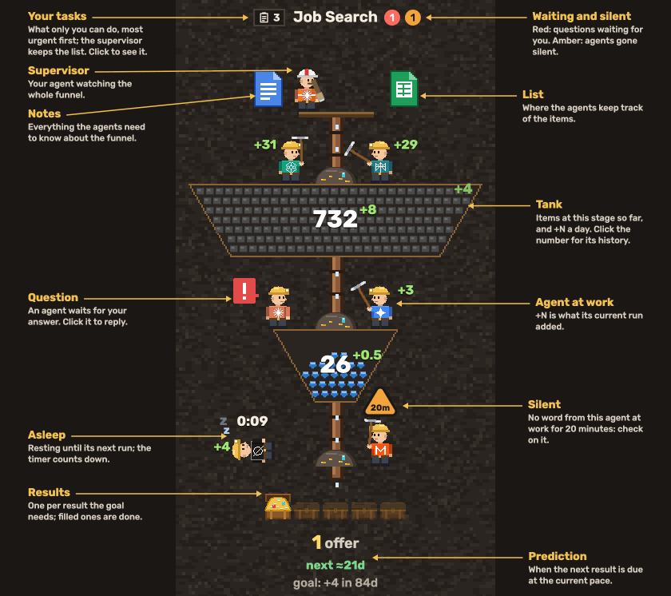

#  Goalcraft

Watch AI agents craft your goals — [goalcraft.ai](https://goalcraft.ai) · [live demo](https://goalcraft.ai/demo/).

Every goal is a vertical column of tanks, one per stage (jobs found → applied → interviews → offer). Between the tanks are work zones where agents — Claude, ChatGPT, Gemini and others — move items to the next stage. Results drop out at the bottom. On a platform at the top of the funnel stands its supervisor: your own agent that watches the whole funnel, finds the bottleneck, answers your questions about it and helps you add worker agents. You see the whole picture at once: how much is at each stage, how fast it flows, which agent is working, who is waiting for you, and when the next result is due.

The dashboard is read-only. Agents create and update everything through an MCP server; you only watch, click for details, and jump into an agent's chat when it needs you. Protocol, data model and how the readings are estimated: [docs/MCP.md](docs/MCP.md).

Live at [goalcraft.ai](https://goalcraft.ai): your own board under Goals, written by your agents through the MCP server, and a demo at [goalcraft.ai/demo](https://goalcraft.ai/demo/) on made-up data (`src/data.js`).

## Connect an agent

Copy the prompt from [goalcraft.ai/connect](https://goalcraft.ai/connect/) into a new chat with your AI agent (Claude, ChatGPT, Cursor or any other that supports MCP). The agent connects the MCP server `https://goalcraft.ai/mcp` (or tells you how: Claude: Connectors → Add custom connector; Claude Code: `claude mcp add --transport http goalcraft https://goalcraft.ai/mcp`; ChatGPT: Developer mode → Create), you sign in on goalcraft.ai and allow it. Then it asks you about the goal, sets up its funnel and becomes the funnel's supervisor: it checks the funnel on a schedule, writes what it found by itself on the dashboard (all good, a bottleneck or a recommendation), asks you when it needs your decision, keeps a list of the things only you can do and, when a stage needs one, writes a ready prompt for a worker agent that you paste into another chat. One chat per goal. Details: [docs/MCP.md](docs/MCP.md).

## How to read it



| On screen | Meaning |
|---|---|
| Supervisor on the platform at the top | Your agent over the whole funnel: it walks the platform and looks down with a spyglass. Click it for what its last check found, a coloured status (all good, bottleneck, recommendation) with one line, its previous checks and its chat. Lying: asleep until its next check; a red `!`: it asks you something, as a worker does |
| A clipboard with a number left of the funnel's title | Your tasks: what only you can do for this funnel (a test task, a form, a reply to a recruiter), most urgent first, with a deadline (red once past) and a link. Every agent of the funnel, the supervisor too, sees the same list and can change it: add a task (ask any of them to, and it will) or mark one done; the supervisor also keeps it in order. You only see it. Click the clipboard for the list. Unlike a question, a task doesn't hold the agents up |
| Empty platform | The funnel has no supervisor yet; click it for how to appoint one |
| Documents on the platform | On the left, the funnel's notes: one document (a Google Doc, a Notion page…) with everything its supervisor and workers need to know, which the supervisor keeps where you chose and every agent reads at the start of a run. On the right, the funnel's list (Google Sheets, Notion, Airtable…). Either shows only when the funnel has its link; hover for where it is kept, click to open it |
| Tank, its number and the small `+N` by it | How many items have reached this stage (cumulative) and how many it gains per day (average over the last 7 days; an agent can set it; `+0` until there are two reports to compare). Per hour, day or week, the same on every funnel: pick it under Flows in the profile menu (per day until then); the unit is not written. The tanks make one funnel: their sides lie on two straight lines, cut by the gaps between them. What a tank holds piles up from the bottom, one piece per item (each new one drops in from the pipe; when the board opens, every tank fills to its count in about 4 seconds), until the tank is full: pieces are the same size in every theme, so a 5-stage funnel's tanks hold about 169, 134, 99, 64 and 29 from top to bottom. The lab's liquid stands as high as such a heap would, full at the same count. In the profile menu, the switch "Tanks grow with items" makes each tank as tall as what it holds (see [Tank sizes](#tank-sizes)). Hover a tank for its name. Click its number (or the `+N`) for its history: a bar of how much it grew per hour, day or week, as the flows (over 1, 3 or 7 days of hours, 7, 30 or 90 days, or 8, 26 or 52 weeks, each once the stage has that much history, or all of it), with the period's total and average. The chart's own hour/day/week switch is the same as Flows in the profile menu: it changes the whole board |
| Agent with a tool | Working on that step |
| Agent lying with a timer | Waiting for its next scheduled run |
| Agent lying under an amber triangle with `2 h` | Did not wake up on time: its run was due more than 10 minutes ago and it has not reported since (agents report `work` first thing in a run; the same 10 minutes of silence as for an agent at work). Click it (or the triangle) for when it was last heard from, and check on the agent. An amber badge by the funnel's title counts its agents under a triangle |
| Writing to an agent | Click any agent, the supervisor too, to write to it; it reads the message on its next run (at once if it is working) and replies over its head. With the [wake script](wake/README.md) on your computer (your agent sets it up when you agree), agents in the Claude app or Codex wake within seconds to read it |
| A note over an agent | Its short reply to your answer or message ("Thanks, sending it now"); it stays until × closes it |
| Agent at work under an amber triangle with `20m` | No word from it for that long: agents send a heartbeat when they wake up and every 5 minutes while they work, and the board waits twice that: after 10 minutes of silence it may have stopped without saying so |
| Agent with a red `!` | Waiting for you; click to read the question and answer it. One `!` per open question (`!!` for two, up to four; from five, the number: `5!`), each answered on its own. Lying with a `!` bubble: it asked, then went to sleep, and takes your answer on its next run. The red badge in the header counts them |
| `+N` by an agent | What its current run added (its last run's while it sleeps). Click the agent and open "Previous runs" for its last 10 runs: the time each started (no date: runs are frequent), how long it took, what it added and what it cost at API prices; on top, its last day's cost and its share of the plan's limit (as Codex logs it; for Claude, ≈ its cost at the rate measured from hourly readings of the weekly limit). Hover a cost for its tokens by kind. The costs come from the [wake script](wake/README.md#token-use), which reads them from the agent's app on your computer (Claude Code, Codex); agents in web chats show none |
| `− 100% +` by the logo | Zoom: 100% is the same size on every screen, a phone too, and the choice is kept in this browser. When the top bar doesn't fit in one line (a phone, a narrow window), it shows the logo's mark alone and just `−` `+` |
| Bottom zone and items | Results so far in one line ("7 offers"), when the next one is due, and the goal: how many are still to add and the time left to its date, counting down in the unit picked for flows (`goal: +23 in 46d` when flows are per day); past the date, how late it is, in red |

## Tank sizes

A tank's height is counted in rows of pieces, one row being one piece tall; every theme's piece is the same size, so a tank holds as many in every theme. The lab's tanks hold a liquid instead, measured the same way: full at the count a heap would fill.

| Look (profile menu) | Height of a tank | Fills |
|---|---|---|
| Fixed (the default, the switch off) | 6 rows, every tank | up to its count, then stays full |
| Growing (the switch on) | as many rows as its count needs: at least 3 (so its number fits), at most 30 | the lab's liquid by its count while the tank is at its smallest; once it has grown, to the top |

The tanks' sides lie on two straight lines in both looks, from 184 units wide at the top of the first tank to 26 at the bottom of the last, so a tank's width, and what a row holds, depends on where it is. How many a tank holds, for a funnel of five stages:

| Tank | Fixed (6 rows) | Growing at 3 rows | Growing, all at 30 rows |
|---|---|---|---|
| 1st (top) | 169 | about 85 | 820 |
| 2nd | 134 | | 658 |
| 3rd | 99 | | 492 |
| 4th | 64 | | 328 |
| 5th (bottom) | 29 | about 15 | 163 |

When the board opens, every tank fills to its count in about 4 seconds, however many pieces it holds.

## Themes

Each funnel picks a look; the data and behaviour are the same.


| Theme | Agents | Work piece | Tanks fill with (piece by piece) | Results |
|---|---|---|---|---|
| `mine` | miners with pickaxes | ore rock | ore and gems, richer by stage | treasure chests |
| `lab` | chemists pouring reagents | Petri dish | liquid, deeper colour by stage | flasks |
| `garden` | gardeners with shears | flower bed | sprouts, buds, then pink, red and purple flowers | flower pots |
| `love` | cupids with bows | bed | flowers, love letters, hearts, kisses, rings: pink to red | hearts |
| `code` | hackers on laptops | server rack | floppy disks: blue, green, yellow, orange, purple by stage | chips |
| `money` | bankers with stamps | contract | copper pennies, banknotes, silver bars, gold bars, bitcoins | money bags |
| `forge` | smiths with hammers | anvil with a red-hot bar | ore, iron ingots, horseshoes, swords, shields | gold crowns |
| `bakery` | bakers with rolling pins | dough on a board | loaves of bread, pizza slices, croissants, cupcakes, glazed doughnuts | strawberry pastries |
| `blocks` | block-headed heroes in diamond armour with swords | a slime they fight | blocks from common to rare: grass, wooden planks, cobblestone, gold, diamond | diamonds |

## Agents


| Id | Agent |
|---|---|
| `claude` | Claude |
| `chatgpt` | ChatGPT |
| `grok` | Grok |
| `gemini` | Gemini |
| `deepseek` | DeepSeek |
| `kimi` | Kimi |
| `qwen` | Qwen |
| `mistral` | Mistral |
| `perplexity` | Perplexity |
| `hermes` | Hermes (Nous Research) |

Any other agent name gets a plain grey shirt. Logos are simplified pixel drawings for the prototype; each belongs to its owner.

## Sign-in

There are no passwords. Sign in with Google, or with your email: the site sends a one-time sign-in link (a new one can be asked for after a minute), in the language of the site (the one picked on the sign-in page for a new account, the account's own after that; English when none is known). The first sign-in creates the account. Google and an email link with the same address lead to the same account. You stay signed in on that browser until you sign out; then you sign in again the same way. Tick "Email me" in the menu to get an email whenever an agent asks you a question (the same question asked again is not sent twice); untick it to stop. Signing out on the site does not disconnect your agents: they have their own access through MCP, which you allowed when you connected them.

## Languages

The site and the dashboard speak English, Russian, Spanish, Portuguese (Brazil), Chinese (simplified), Japanese, Korean, Turkish, Thai and Vietnamese. The picker is in the nav. The first visit follows the browser's language (English if it is none of these). The choice is kept in the browser and, once signed in, in the account, so it follows you to other devices. `?lang=ru` in the address opens a page in that language without remembering it.

Times use one short unit right after the number, the same everywhere: `45s`, `15m`, `8h`, `3d`, `2w` (in Russian с, м, ч, д, н). There are no months, so `m` is always minutes. Flows on the board are a bare `+8` in the unit picked in the profile menu.

All interface text is in `src/i18n.js` (one entry per phrase with a version per language) and `src/lang/` (one file per newer language, keyed the same way); a new language is one more file there, a line in `LANGS` and a column in the demo names in `src/data.js`. Vietnamese pages use the Be Vietnam Pro font (Rubik has no Vietnamese letters), Japanese ones Noto Sans JP, Korean ones Noto Sans KR. Funnel, stage and result names on your own dashboard are whatever your agents write, in your language. The pitch deck, the docs and the MCP tool descriptions stay in English.

## Run

```bash
python3 serve.py
```

Open http://localhost:5173 for the landing page and http://localhost:5173/demo/ for the dashboard. The server turns caching off so a reload always picks up changes.

The MCP server deploys with the Supabase CLI: `supabase db push` for the tables, `supabase functions deploy mcp --use-api` for the server (it needs the secret `MCP_AUTH_ISSUER`, the project's Auth issuer).

To refresh the README pictures, open http://localhost:5173/tools/render-docs.html; it redraws `docs/img/agents.png`, the animated `themes.gif` and `funnel.gif` (with `funnel.png` for the deck and `funnel-plain.png`, the landing page's still), and the link preview card `og.png` with the dashboard's own drawing code. `?only=themes`, `?only=funnel` or `?only=og` redraws just one. The landing page runs the same funnel live (`src/guide.js`).

The sign-in emails are built in every site language by `python3 tools/email-templates.py` into `supabase/templates/` (`magic_link.html`, `confirmation.html` and `subject.txt`); they take effect once applied to the project's Auth settings (Management API `PATCH /v1/projects/{ref}/config/auth`: the magic link and confirmation content, and `subject.txt` as both subjects). Supabase keeps the old email text for up to about ten minutes after that.

## Code

Scripts and stylesheets are loaded with a version in the address (`i18n.js?v=3f2a1c9e`), so a browser that still holds yesterday's files never runs a new page with an old script. Before committing a change to `src/`, a page or the CSS, run `python3 tools/stamp.py`: it sets the version, a hash of all the scripts and styles, in every reference.

- `src/i18n.js` — interface languages: detection, the picker's choice, every text in English, Russian, Chinese and Thai; `src/lang/` — Spanish, Vietnamese, Japanese, Portuguese, Turkish and Korean, merged in by key
- `src/data.js` — demo funnels (with their translations) and the agent list
- `src/scene.js` — Canvas 2D scene: layout, simulation, heaps, hit areas
- `src/themes.js` — themes: column backdrop, work piece, tank filling, result item
- `src/sprites.js` — agents (outfits, tools, logos) and supervisors (a manager's outfit per theme, spyglass) drawn from shapes on a half-unit grid
- `src/dashboard.js` — page wiring: scaling, sticky titles, drag to reorder, popups, answers to agents
- `src/main.js` — the demo; `src/live.js` — the person's funnels from the database, flows from the count history, live updates
- `src/guide.js` — the explained funnel: run live on the landing page (`src/guide-live.js`), recorded for the README
- `src/nav.js` — the nav: language picker, Goals and Sign out once signed in
- `index.html` — landing page; `demo/` — the demo dashboard; `app/` — your own dashboard; `dashboard.css` — their styles
- `login/` — sign-in with Google or an email link (Supabase Auth); `oauth/consent/` — where you allow an agent to connect; `connect/` — the prompt that connects Goalcraft and makes an agent the goal's supervisor; `pricing/` — Free and Pro plans ($9 a month during early access, through Polar); `privacy/`, `contact/`
- `src/billing.js`, `src/pricing.js` — paying for Pro: the Get Pro button and the plan in the profile menu; `supabase/functions/billing/` — Polar checkout, the customer portal and the webhook that moves `accounts.pro_until`; `terms/` — terms of service
- `src/config.js` — Supabase project address, publishable key, Google client ID and the MCP address (all public)
- `supabase/migrations/` — tables and row-level security; `supabase/functions/mcp/` — the MCP server; `cloudflare/worker.js` — serves it and its sign-in at goalcraft.ai (routes `/mcp*`, `/auth/*`, `/.well-known/*`)
- `docs/MCP.md` — the MCP protocol agents use to write to the dashboard
- `wake/` — the optional wake script for your computer: wakes agents in the Claude app and Codex when something waits for them and sends their token use; `supabase/functions/wake/` — what it asks
- `sitemap.xml`, `robots.txt` — the public pages for search engines (the board, sign-in and consent pages stay out); add a new public page to the sitemap
